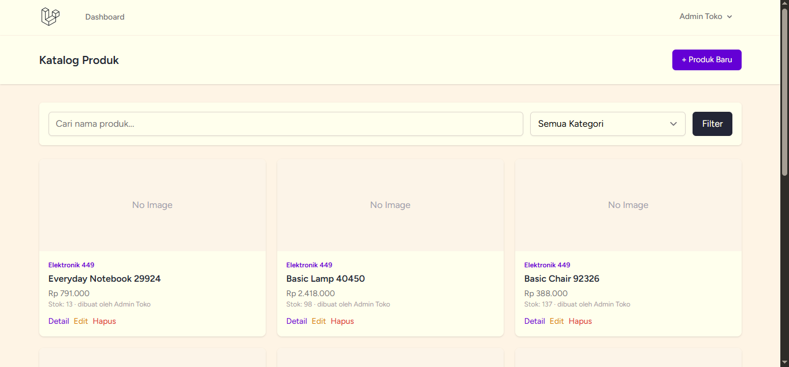
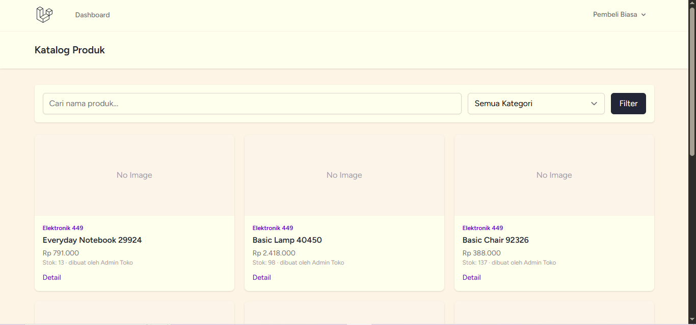
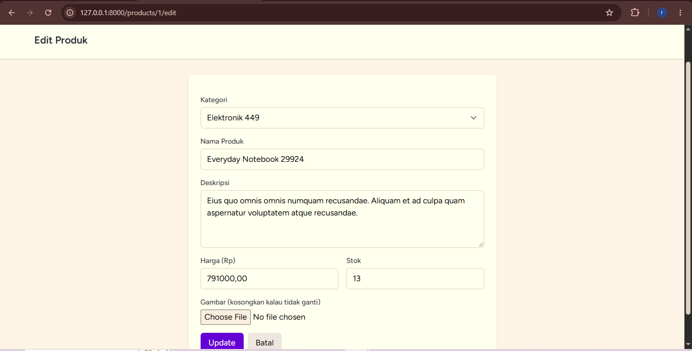
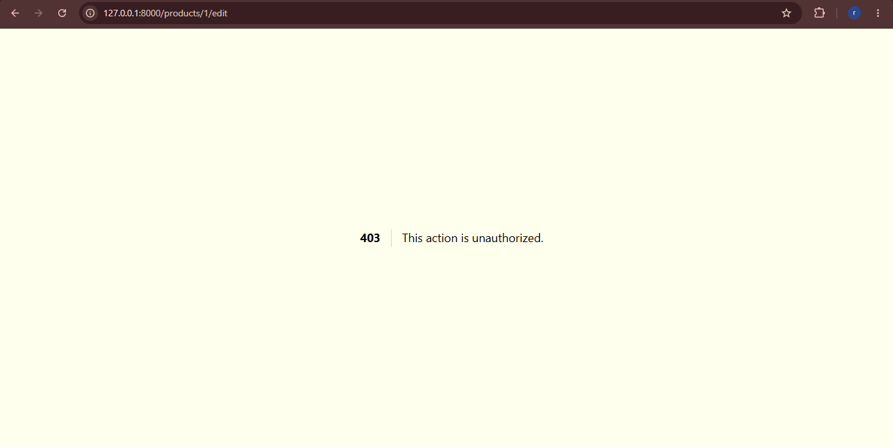
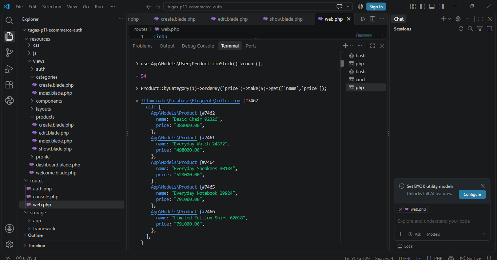
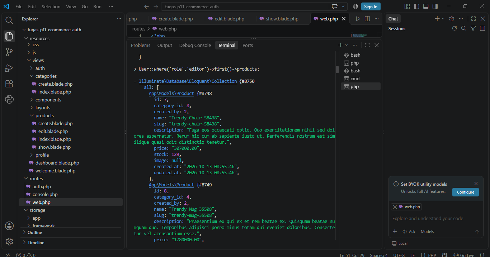
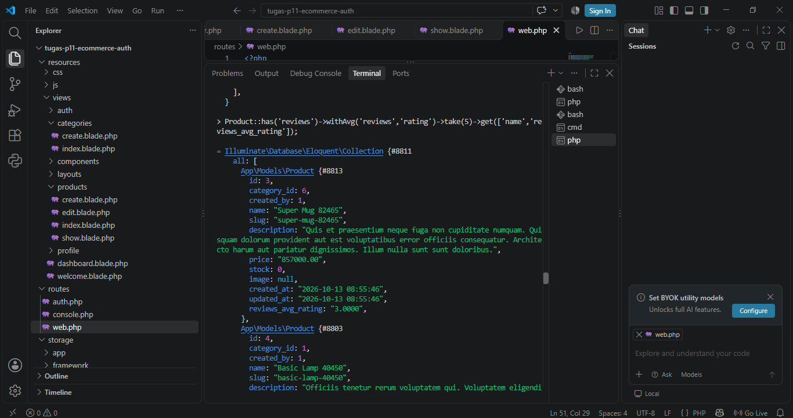
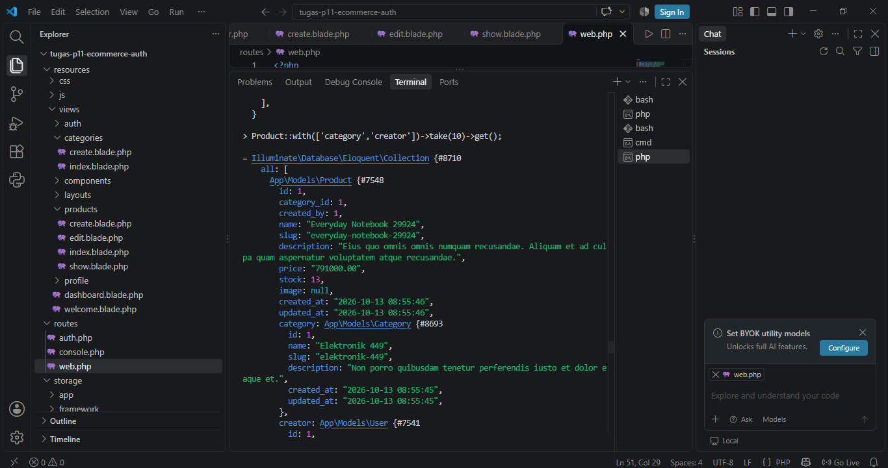

# Tugas Rutin 11 — E-Commerce DB + Secure Auth

Nama: Rachel Aulia
Mata Kuliah: Pemrograman Web
Repo: `TugasWeb-P11-EcommerceAuth`

Aplikasi katalog produk e-commerce dengan database relasional (7 tabel + FK),
autentikasi via Laravel Breeze, role-based access control (admin/editor/user)
pakai custom middleware, dan otorisasi edit/hapus produk pakai Policy.

---

## Bagian A — Database & Eloquent

- **Migrations**: 7 tabel e-commerce (`categories`, `products`, `carts`, `cart_items`,
  `orders`, `order_items`, `reviews`) + migration tambahan yang menambah kolom
  `role` ke tabel `users` bawaan Breeze. Semua FK pakai `constrained()->cascadeOnDelete()`.
- **Factories + Seeders**: `ProductSeeder` membuat **60 produk** (lebih dari syarat
  minimal 50), tersebar ke 8 kategori acak, plus review acak per produk.
- **Models + Relationships**: `User`, `Category`, `Product`, `Cart`, `CartItem`,
  `Order`, `OrderItem`, `Review` — semua relasi `belongsTo`/`hasMany` sudah dipasang.
- **Scope**: `Product::scopeInStock()` (wajib rubrik) + `Product::scopeByCategory()` (tambahan).

## Bagian B — Auth & Security

- **Breeze**: login/register/logout (langkah install di bawah, karena Breeze
  harus di-install lewat Composer di komputermu sendiri).
- **Multi-role**: kolom `role` di tabel `users` (`admin`/`editor`/`user`) +
  middleware custom `EnsureUserHasRole` (alias `role`).
- **Policy**: `ProductPolicy` mengatur siapa boleh edit/hapus produk (lihat
  penjelasan di bawah — rubrik menyebutnya "PostPolicy" tapi di sini jadi
  `ProductPolicy` karena studi kasusnya e-commerce, fungsinya tetap sama).
- **Route protection**: dijelaskan + cara testing pakai 2 role di bawah.

## Bonus

- Filament admin panel (opsional, panduan singkat di bagian bawah — pakai
  PDF "Praktik Laravel - Filament.pdf" dari dosen sebagai referensi detail).
- Demo eager loading (`Product::with('category','creator')`) ada built-in
  di `ProductController@index`, plus cara membuktikannya di Tinker (langkah 8).

---

## Aturan Role (penting, buat dipahami sebelum testing)

| Role   | Lihat produk | Tambah produk | Edit/Hapus produk |
|--------|:---:|:---:|:---:|
| admin  | ✅ | ✅ | ✅ semua produk |
| editor | ✅ | ✅ | ✅ **hanya produk buatannya sendiri** |
| user   | ✅ | ❌ (403) | ❌ (403) |

- **Middleware** `role:admin,editor` yang jaga route `/products/create` —
  kalau `user` biasa coba akses, langsung ketolak sebelum masuk controller.
- **Policy** `ProductPolicy` yang jaga `edit`/`update`/`destroy` — ini dicek
  di DALAM controller (`$this->authorize(...)`), jadi walau semua role yang
  login bisa "masuk" ke route-nya, yang beneran boleh lanjut cuma admin atau
  editor-pemilik. Ini membuktikan dua lapis keamanan: middleware (role) +
  policy (kepemilikan data).

---

## Langkah 1 — Siapkan proyek Laravel + Breeze

Buka Command Prompt di VS Code (bukan PowerShell/bash), lalu:

```
cd D:\
composer create-project laravel/laravel tugas-p11-ecommerce-auth
cd tugas-p11-ecommerce-auth
composer require laravel/breeze --dev
php artisan breeze:install blade
npm install
npm run build
```

Pas `breeze:install` nanti ada prompt pilih testing framework — pilih **Pest** atau **PHPUnit**, bebas, pencet Enter aja.

## Langkah 2 — Database

1. Buka MySQL Workbench / command line MySQL kamu, buat database baru:
   ```sql
   CREATE DATABASE db_tugas_p11;
   ```
2. Buka file `.env` di root project, pastikan baris-baris ini **tidak** diawali `#` (uncomment) dan diisi sesuai punyamu:
   ```
   DB_CONNECTION=mysql
   DB_HOST=127.0.0.1
   DB_PORT=3306
   DB_DATABASE=db_tugas_p11
   DB_USERNAME=root
   DB_PASSWORD=password_mysql_kamu
   ```
3. Simpan file (Ctrl+S) — pastikan titik `●` di tab VS Code hilang.

## Langkah 3 — Copy file-file yang aku kirim ke project

Semua file yang aku kirim **menggantikan/menambah** file di project barumu. Petanya:

| File yang aku kirim | Taruh di |
|---|---|
| `2026_02_01_*.php` (8 file) | `database/migrations/` |
| `CategoryFactory.php`, `ProductFactory.php`, `ReviewFactory.php` | `database/factories/` |
| `UserRoleSeeder.php`, `CategorySeeder.php`, `ProductSeeder.php`, `DatabaseSeeder.php` | `database/seeders/` (timpa `DatabaseSeeder.php` yang sudah ada) |
| `User.php` | `app/Models/` (**timpa** `User.php` bawaan Breeze) |
| `Category.php`, `Product.php`, `Cart.php`, `CartItem.php`, `Order.php`, `OrderItem.php`, `Review.php` | `app/Models/` |
| `EnsureUserHasRole.php` | `app/Http/Middleware/` (buat foldernya kalau belum ada) |
| `ProductPolicy.php` | `app/Policies/` (buat foldernya kalau belum ada) |
| `CategoryController.php`, `ProductController.php` | `app/Http/Controllers/` |
| Folder `products/` dan `categories/` (isinya file `.blade.php`) | `resources/views/` |
| `web.php` | **Jangan ditimpa langsung!** Buka file `web.php` yang aku kirim, copy bagian yang ada di bawah komentar `ROUTE TR11` sampai akhir file (sebelum `require __DIR__.'/auth.php';`), lalu tempel ke `routes/web.php` project-mu (yang sudah ada punya Breeze), taruh sebelum baris `require __DIR__.'/auth.php';` yang sudah ada |

## Langkah 4 — Daftarkan middleware `role`

Buka `bootstrap/app.php`, cari bagian `->withMiddleware(function (Middleware $middleware) {`, tambahkan di dalamnya:

```php
$middleware->alias([
    'role' => \App\Http\Middleware\EnsureUserHasRole::class,
]);
```

Kalau isinya masih kosong (`//`), ganti jadi:

```php
->withMiddleware(function (Middleware $middleware) {
    $middleware->alias([
        'role' => \App\Http\Middleware\EnsureUserHasRole::class,
    ]);
})
```

## Langkah 5 — Migrate + Seed

```
php artisan storage:link
php artisan migrate:fresh --seed
```

Kalau sukses, kamu akan punya 3 akun demo (semua password-nya **`password`**):

| Email | Role |
|---|---|
| admin@example.com | admin |
| editor@example.com | editor |
| user@example.com | user |

Plus 60 produk di 8 kategori sudah ke-seed otomatis.

## Langkah 6 — Jalankan & test

```
php artisan serve
```

Buka `http://127.0.0.1:8000`, register akun baru (otomatis dapat role `user`), atau login pakai salah satu akun demo di atas.

### Checklist testing fungsional

- [ ] Register akun baru → cek role default-nya `user`
- [ ] Login/logout jalan normal (Breeze)
- [ ] Login sebagai `user@example.com` → tombol "+ Produk Baru" **tidak muncul**, dan kalau akses manual `/products/create` → dapat **403**
- [ ] Login sebagai `editor@example.com` → bisa tambah produk, bisa edit/hapus **produk buatannya sendiri**, tapi kalau coba edit produk buatan admin/editor lain → **403**
- [ ] Login sebagai `admin@example.com` → bisa edit/hapus **semua** produk, dan bisa akses `/categories` untuk kelola kategori
- [ ] Filter kategori & pencarian nama produk di halaman katalog jalan

### Testing 2 role sekaligus (incognito) — wajib buat rubrik "Route protection"

1. Login sebagai `admin@example.com` di browser normal.
2. Buka jendela **Incognito/Private** baru, login sebagai `user@example.com` di situ.
3. Di jendela incognito, coba buka langsung URL edit produk punya admin, contoh `http://127.0.0.1:8000/products/1/edit` → harus muncul halaman **403 Forbidden**.
4. Screenshot kedua jendela berdampingan (admin bisa edit, user kena 403) buat dilampirkan ke laporan.

## Langkah 7 — Dokumentasi 5 Query Tinker (wajib screenshot)

Jalankan `php artisan tinker` di terminal, lalu jalankan satu-satu query di bawah, screenshot tiap hasilnya:

```php
// 1. Ambil semua produk yang stoknya masih ada (pakai scope)
Product::inStock()->count();

// 2. Ambil 5 produk termurah di kategori tertentu (pakai scope + relasi)
Product::byCategory(1)->orderBy('price')->take(5)->get(['name','price']);

// 3. Relasi: lihat semua produk yang dibuat oleh seorang editor
User::where('role','editor')->first()->products;

// 4. Relasi + agregasi: rata-rata rating tiap produk yang punya review
Product::has('reviews')->withAvg('reviews','rating')->take(5)->get(['name','reviews_avg_rating']);

// 5. Eager loading: ambil produk beserta kategori & pembuatnya sekaligus (hemat query)
Product::with(['category','creator'])->take(10)->get();
```

Simpan kelima screenshot itu (kasih nama file `tinker-1.png` s/d `tinker-5.png`), nanti kita masukkan ke README final dan folder `screenshots/`.

## Langkah 8 (Bonus) — Demo Eager Loading (N+1 problem)

Buktikan kenapa eager loading penting, jalankan di Tinker:

```php
// AKTIFKAN query log
DB::enableQueryLog();

// Tanpa eager loading -> akan jalanin query category TERPISAH untuk TIAP produk (N+1!)
$products = Product::take(10)->get();
foreach ($products as $p) { $p->category->name; }
count(DB::getQueryLog()); // catat angkanya, misal 11 query

DB::flushQueryLog();

// Dengan eager loading -> cuma 2 query total, berapa pun jumlah produknya
$products = Product::with('category')->take(10)->get();
foreach ($products as $p) { $p->category->name; }
count(DB::getQueryLog()); // catat angkanya, harusnya cuma 2
```

Screenshot kedua angka itu (yang tanpa `with()` jauh lebih banyak query-nya) sebagai bukti bonus eager loading.

## Langkah 9 (Bonus) — Filament Admin Panel

Kalau mau kejar bonus ini juga:

```
composer require filament/filament:"^3.2" -W
php artisan filament:install --panels
php artisan make:filament-user
```

Ikuti prompt `make:filament-user` buat bikin akun admin panel (boleh pakai email `admin@example.com` yang sama). Lalu bikin resource untuk Product:

```
php artisan make:filament-resource Product --generate
```

`--generate` otomatis membuat form & tabel berdasarkan kolom di migration `products`. Buka `http://127.0.0.1:8000/admin` untuk lihat hasilnya. Detail lebih lengkap (styling form, relation manager, dll) ada di PDF "Praktik Laravel - Filament.pdf" yang sudah kamu punya dari dosen.

## Langkah 10 — Update README & push ke GitHub

1. Tambahkan screenshot kamu (hasil testing Langkah 6-8) ke folder `screenshots/` di project, lalu sisipkan ke README ini pakai ``.
2. Push ke GitHub (ganti `racellauliaa-pixel` kalau usernamemu beda):
   ```
   git init
   git add .
   git commit -m "TR11: E-commerce DB + Secure Auth"
   git branch -M main
   git remote add origin https://github.com/racellauliaa-pixel/TugasWeb-P11-EcommerceAuth.git
   git push -u origin main
   ```
3. Buat repo baru di GitHub dulu dengan nama **persis** `TugasWeb-P11-EcommerceAuth` sebelum push, kalau belum ada.

---

## Checklist Rubrik Lengkap

- [x] Migrations 7 tabel e-commerce + FK constraints
- [x] Seeders + factories (60 produk realistis > 50)
- [x] Models + relationships + minimal 1 scope (ada 2: `inStock`, `byCategory`)
- [ ] Dokumentasi 5 query Tinker (screenshot) — dikerjakan user di Langkah 7
- [ ] Install Breeze (login/register/logout) — dikerjakan user di Langkah 1
- [x] Multi-role (admin/editor/user) + custom middleware
- [x] ProductPolicy untuk otorisasi edit/delete
- [ ] Route protection + testing incognito 2 role — dikerjakan user di Langkah 6
- [ ] Bonus: Filament admin panel — opsional, Langkah 9
- [x] Bonus: eager loading demo (built-in di controller + cara buktikan di Langkah 8)

## Bukti Testing (Screenshot)








